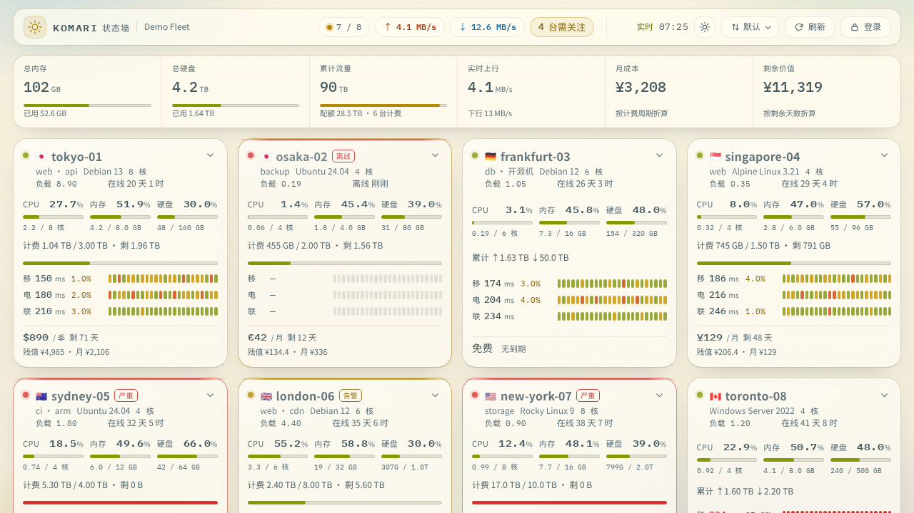
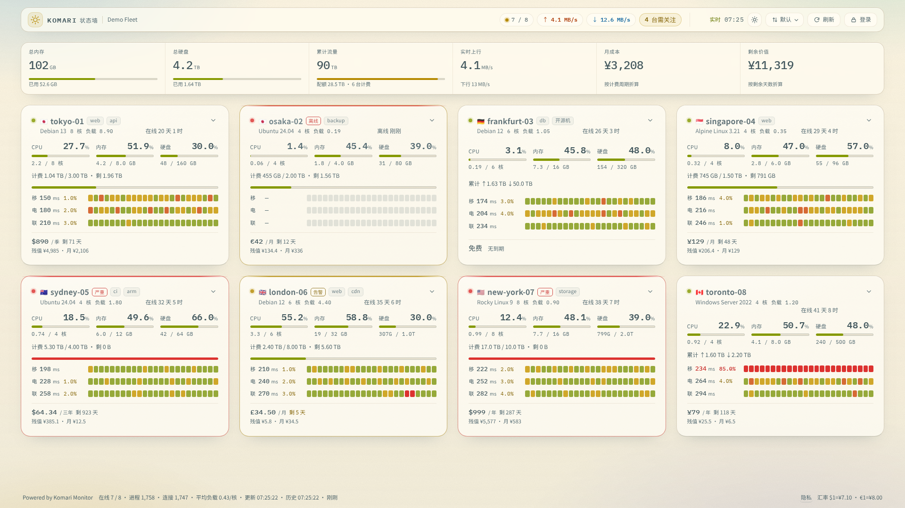
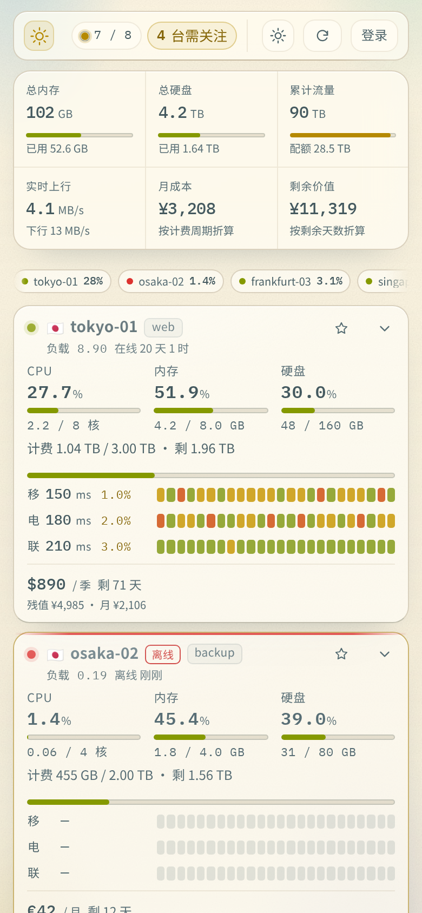

# Komari StatusWall

> A Solarized "status wall" theme for [Komari Monitor](https://github.com/komari-monitor/komari) — one glass card per server, all of them on the first screen, and the live data itself is the decoration.

**[中文说明](README.zh-CN.md)**



| Desktop (1920×1080) | Phone (390×844) |
| --- | --- |
|  |  |

All screenshots use synthetic demo data. Laptop size: [docs/screenshots/laptop.png](docs/screenshots/laptop.png); full-length phone page: [docs/screenshots/mobile-full.png](docs/screenshots/mobile-full.png).

## What it is

StatusWall turns the Komari node list into a wall you can read at a glance. Each server is a
rounded glass card on cream paper: vitals first, a 3×24 latency/loss signal strip below them,
money and remaining value at the bottom. Nothing moves unless the data moves.

Every number the default theme shows is still here, plus a few it never surfaced:

| On the card | In the detail panel (click anywhere on a card) |
| --- | --- |
| CPU / memory / disk, each as `%` **and** `used / total` | 20+ sensor rows: CPU model, cores, GPU, kernel, virtualisation, swap, load 1/5/15, TCP/UDP connections, process count, uptime, traffic in/out, cost model, expiry, remaining value, group, tags, remark |
| Cumulative traffic vs. quota, with a bar | Four hourly trend charts — CPU, memory, disk, network |
| Live up/down speed | Per-carrier latency stats: latest, average, min, max, loss |
| 3 carriers × 24 five-minute buckets of latency and loss | Node message, billing details, manage/created time, last report |
| Price, billing cycle, days left, remaining value | |

The fleet totals sit above the wall: total memory, total disk, total traffic, real-time up/down,
monthly cost, remaining value — plus a "N need attention" counter, the clock, theme and sort
controls.

## Design notes

- **Solarized light and dark.** `#fdf6e3` base3 in light mode, `#002b36` base03 in dark; all text
  and status colours come from a token pair (graphic colour + ink colour) so both schemes stay
  readable.
- **Glass, not flat.** Cards use a layered translucent surface with a soft inner highlight and a
  static grain, so the wall reads as one physical object rather than eight boxes.
- **The data is the visual.** No background photos, no globe, no map. The only "graphic" is the
  latency strip, and it only exists because there is real data behind it.
- **Quiet by default.** Charts live only in the expanded detail view; the card shows numbers.
- **One screen.** On a 1920×1080 viewport all eight nodes are visible without scrolling. The
  layout fits 4 / 3 / 2 / 1 columns to the window, so it also works on a phone.
- **Says what's wrong first.** A small `在线` / `告警` / `离线` chip sits next to every name, and the
  header's `N 台需关注` button jumps to the first card that needs attention. Offline nodes can be
  sorted to the end of the wall.
- **Keyboard and screen-reader aware.** Native buttons for every action, visible focus rings,
  `aria-expanded` / `aria-controls` on the detail toggle, `aria-pressed` on pin and privacy,
  tooltips that also appear on focus, `prefers-reduced-motion` respected, and a print stylesheet.

## Requirements

- Komari Monitor with the public theme API (`/api/public`, `/api/nodes`, `/api/task/ping`,
  `/api/rpc2`, WebSocket `/api/clients`).
- Node.js 18+ only if you build from source. The released zip has no runtime dependencies.

## Install

**From a release zip**

1. Download `StatusWall-<version>.zip` from the releases page.
2. In the Komari admin, open **主题 / Themes** and install the zip (or unzip it into
   `data/theme/StatusWall/` so that `komari-theme.json` and `dist/` sit at that level).
3. Select **Komari StatusWall** as the active theme and open the site.

**Try it locally (synthetic data, no Komari needed)**

```bash
npm run demo           # builds, then serves a demo with fake nodes on http://127.0.0.1:8090
```

**From source**

```bash
git clone https://github.com/Tron521/komari-theme-statuswall.git
cd komari-theme-statuswall
npm run build          # -> theme/dist (no dependencies)
npm run package        # -> dist-package/StatusWall-<version>.zip
```

## Settings

Everything is configured in the admin under the theme settings; the theme ships with no external
calls.

| Key | Default | What it does |
| --- | --- | --- |
| `refreshInterval` | `3` | WebSocket refresh interval, 2–30 s |
| `historyHours` | `2` | Window for the ping strip and detail trends: 1, 2, 3 or 6 h |
| `showTrace` | `true` | Show the four hourly trend charts in the detail panel |
| `warnThreshold` | `85` | Usage above which a vital turns amber |
| `colorMode` | `auto` | `auto` / `light` / `dark` (the header toggle overrides it per browser) |
| `showAdmin` | `true` | Show the Login / Admin button in the header (links to `/admin`); turning it off only hides the button |
| `hiddenNodes` | empty | Comma / space / semicolon separated node names or 4-char UUID prefixes; hidden nodes are excluded from cards, totals, alerts and the footer |
| `offlineLast` | `false` | Sort offline nodes to the end of the wall (pinned nodes still come first) |
| `icpText` | empty | Footer text such as an ICP filing number (max 80 chars) |
| `icpUrl` | empty | Optional http(s) link for `icpText`; opens in a new tab |
| `showFinance` | `true` | Show price / monthly cost / remaining value; when off, the two money tiles become process and connection counts |
| `usdCny` | `7.1` | Manual exchange rate for `$` prices |
| `eurCny` | `8.0` | Manual exchange rate for `€` prices |

`hiddenNodes` behaviour: a bare name hides every node with that name; use a comma when the name
itself contains spaces (e.g. `my server, node-a`); a 4-character UUID prefix is enough and case is
ignored.

## Regenerating the screenshots

`npm run preview` builds the theme and renders it against **synthetic fixture data** in
`scripts/fixtures.mjs` — no real Komari instance, no private node names.

```bash
npm install
npx playwright install chromium
npm run preview        # docs/screenshots/*.png + theme/preview.png
```

## Project layout

```
theme/
  komari-theme.json    manifest + settings schema (managed config)
  src/                 index.html, style.css, app.js, assets/fonts
  build.mjs            stamps a content hash into dist (sha256 of css+js+html)
  preview.png          theme preview image
scripts/
  fixtures.mjs         synthetic demo data
  screenshot.mjs       offline screenshot harness (static server + mocked API/WS)
  package.mjs          zip builder, prints sha256
docs/screenshots/      README images
```

`dist/` is generated and intentionally not committed: Komari serves whatever is inside the
installed theme folder, and the release zip is built from `theme/` by `npm run package`.

## Notes on data and privacy

- The theme only calls the Komari instance it is served from; there are no fonts, analytics or
  images fetched from third parties (fonts are bundled).
- A privacy button in the footer swaps node names for `Node-01…NN` locally, hides group/tags/remark,
  and is not persisted to the server.
- Hiding nodes is a display filter, not an access control: the data still comes from the public
  Komari API. Use Komari's own private-site setting if the data must not be public.

## Browser support

Chromium 111+, Firefox 113+, Safari 16.4+ (uses `color-mix()`, `backdrop-filter`, container-less
CSS grid, and `matchMedia`). Older browsers get a readable but flatter page.

## License

MIT — see [LICENSE](LICENSE). Bundled IBM Plex Mono fonts are under the SIL Open Font License 1.1;
see [THIRD-PARTY.md](THIRD-PARTY.md).
