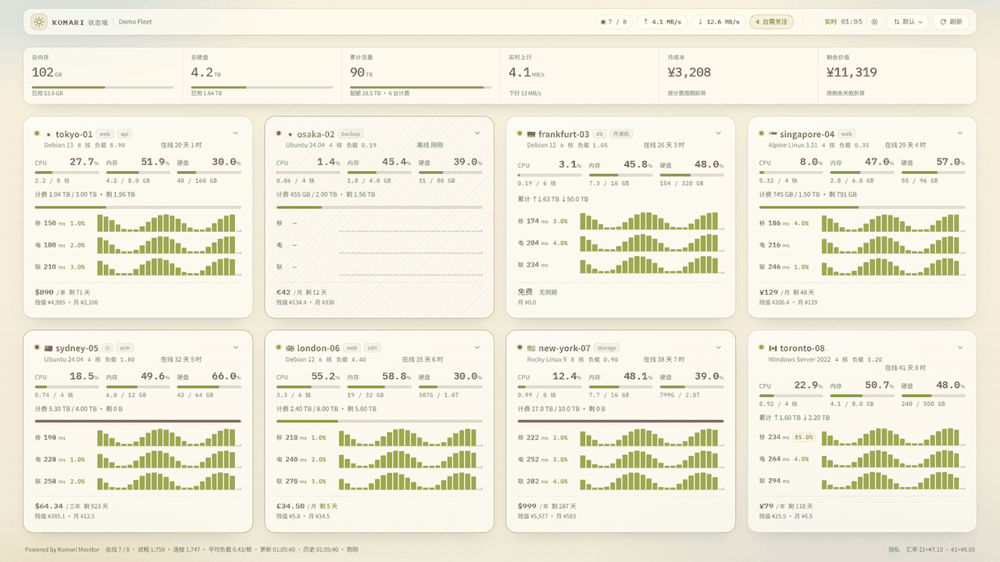
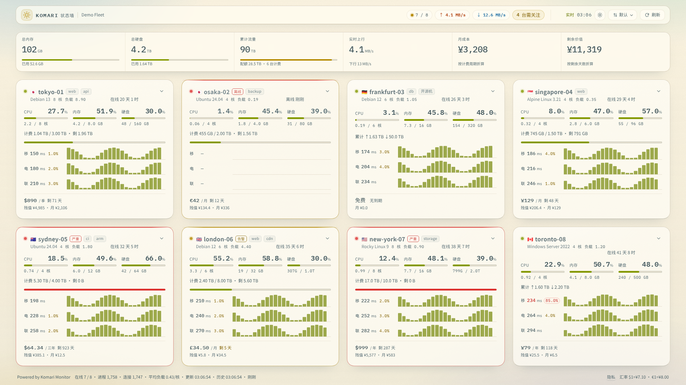
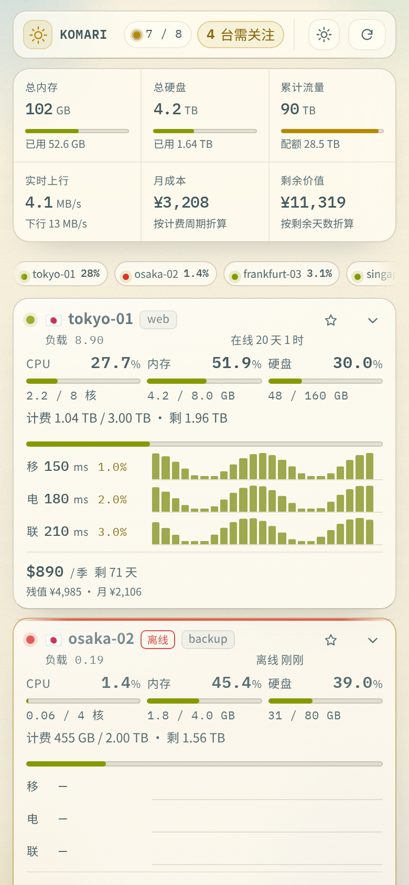

# Komari 状态墙（StatusWall）

> 给 [Komari Monitor](https://github.com/komari-monitor/komari) 做的 Solarized「状态墙」主题：一台机器一张玻璃卡，8 台一屏看全，活数据本身就是装饰。

**[English](README.md)**



| 桌面（1920×1080） | 手机（390×844） |
| --- | --- |
|  |  |

截图都是虚构的演示数据。笔记本尺寸见 [docs/screenshots/laptop.png](docs/screenshots/laptop.png)，手机整页长图见 [docs/screenshots/mobile-full.png](docs/screenshots/mobile-full.png)。

## 这是什么

StatusWall 把 Komari 的节点列表做成一面能一眼扫完的墙。每台机器是一张米白纸上的圆角玻璃卡：
先看三项体征，再看 3×24 的三网延迟/丢包信号条，最下面是钱和剩余价值。数据不动，画面就不动。

默认主题有的数字这里都有，另外补了几项它没露出来的：

| 卡片上 | 详情面板（点卡片右上角的箭头展开） |
| --- | --- |
| CPU / 内存 / 硬盘：百分比 **和** `已用 / 总量` | 20+ 项明细：CPU 型号、核心数、GPU、内核、虚拟化、Swap、1/5/15 负载、TCP/UDP 连接数、进程数、在线时长、上下行流量、计费方式、到期、剩余价值、分组、标签、备注 |
| 累计流量 / 配额，带进度条 | 四张逐小时趋势图：CPU、内存、硬盘、网络 |
| 实时上下行速度 | 三网逐项统计：最新、平均、最小、最大、丢包 |
| 3 网 × 24 个五分钟桶的延迟与丢包 | 节点消息、账单信息、纳管时间、最近上报 |
| 价格、计费周期、剩余天数、剩余价值 | |

墙上方是整队汇总：总内存、总硬盘、累计流量、实时上下行、月成本、剩余价值，以及「N 台需关注」、
时钟、配色/排序/刷新控件。

## 设计说明

- **Solarized 双配色。** 浅色 `#fdf6e3` base3，深色 `#002b36` base03；每个状态色都成对出现
  （图形色 + 文字色），两种配色下都保可读。
- **玻璃而不是色块。** 卡片是多层半透明表面 + 内高光 + 静态颗粒，整面墙像一块东西，而不是八个盒子。
- **数据就是画面。** 没有背景图、没有地球、没有地图。唯一的「图形」是延迟信号条，而它只因为背后有真实数据才存在。
- **默认安静。** 折线只出现在展开的详情里，卡片上只给数字。
- **一屏装下。** 1920×1080 下 8 台机器全部可见，不用滚动；布局按 4 / 3 / 2 / 1 列自适应，手机上也能用。
- **先告诉你哪里不对。** 机器名旁边有小小的「在线 / 告警 / 离线」状态条，顶栏「N 台需关注」点一下直接跳到第一台有问题的机器；离线机器可以排在最后。
- **键盘与读屏可用。** 所有操作都是原生按钮，有可见焦点环，详情按钮带 `aria-expanded` / `aria-controls`，
  置顶与隐私带 `aria-pressed`，提示在键盘聚焦时也会出现，尊重 `prefers-reduced-motion`，并提供打印样式。

## 环境要求

- 带公开主题 API 的 Komari Monitor（`/api/public`、`/api/nodes`、`/api/task/ping`、`/api/rpc2`、
  WebSocket `/api/clients`）。
- 只有从源码构建才需要 Node.js 18+；发布包运行时零依赖。

## 安装

**用发布 zip**

1. 从 Releases 下载 `StatusWall-<version>.zip`。
2. 在 Komari 后台「主题」里安装这个 zip（或解压到 `data/theme/StatusWall/`，让
   `komari-theme.json` 和 `dist/` 处在这一层）。
3. 选中「Komari 状态墙」，打开站点。

**本地试看（合成数据，不需要 Komari）**

```bash
npm run demo           # 构建并在 http://127.0.0.1:8090 起一个带假数据的演示站
```

**从源码构建**

```bash
git clone https://github.com/Tron521/komari-theme-statuswall.git
cd komari-theme-statuswall
npm run build          # 生成 theme/dist（无依赖）
npm run package        # 生成 dist-package/StatusWall-<version>.zip
```

## 设置项

全部在后台的主题设置里，主题本身不请求任何外部资源。

| 键 | 默认 | 作用 |
| --- | --- | --- |
| `refreshInterval` | `3` | WebSocket 实时刷新间隔，2–30 秒 |
| `historyHours` | `2` | 三网信号条与详情趋势图的时间窗，可选 1 / 2 / 3 / 6 小时 |
| `showTrace` | `true` | 是否在详情面板里显示四张逐小时趋势图 |
| `warnThreshold` | `85` | 使用率超过多少转琥珀色 |
| `colorMode` | `auto` | `auto` / `light` / `dark`（顶栏切换会按浏览器覆盖） |
| `showAdmin` | `true` | 顶栏右侧显示「登录 / 后台」按钮（指向 `/admin`）；关闭只隐藏按钮，`/admin` 照常可用 |
| `hiddenNodes` | 空 | 逗号 / 空格 / 分号分隔的机器名或 4 位 UUID 前缀；被隐藏的机器不显示卡片，也不计入汇总、提醒和页脚 |
| `offlineLast` | `false` | 离线机器排到最后（置顶的机器仍最前） |
| `icpText` | 空 | 页脚文字，适合放 ICP 备案号（最多 80 字） |
| `icpUrl` | 空 | 可选的 http(s) 链接；填写后备案文字在新标签页打开 |
| `showFinance` | `true` | 是否显示价格 / 月成本 / 剩余价值；关闭后顶部两格换成进程数与连接数 |
| `usdCny` | `7.1` | `$` 价格的手动汇率 |
| `eurCny` | `8.0` | `€` 价格的手动汇率 |

`hiddenNodes` 的规则：只写名字会隐藏所有同名机器；名字本身带空格时用逗号分隔（如
`my server, node-a`）；UUID 写前 4 位即可，大小写不敏感。

## 重新生成截图

`npm run preview` 会用 `scripts/fixtures.mjs` 里的**合成数据**渲染主题——不连真实 Komari，
也不会出现真实机器名。

```bash
npm install
npx playwright install chromium
npm run preview        # docs/screenshots/*.png + theme/preview.png
```

## 目录结构

```
theme/
  komari-theme.json    清单与设置项（managed 配置）
  src/                 index.html、style.css、app.js、assets/fonts
  build.mjs            把 css+js+html 的 sha256 作为内容哈希写进 dist
  preview.png          主题预览图
scripts/
  fixtures.mjs         合成演示数据
  screenshot.mjs       离线截图（静态服务器 + mock API/WS）
  package.mjs          zip 打包，输出 sha256
docs/screenshots/      README 配图
```

`dist/` 是生成物，故意不进仓库：Komari 直接读安装目录里的文件，发布 zip 由 `npm run package`
从 `theme/` 构建。

## 数据与隐私

- 主题只请求它自己被托管的那个 Komari 实例；字体等资源全部本地打包，不向第三方发请求。
- 页脚的隐私按钮会在本地把机器名换成 `Node-01…NN`，并隐藏分组/标签/备注，状态不写到服务器。
- 「隐藏的机器」是显示过滤，不是权限控制：数据仍然来自 Komari 公开 API。如果数据本身不能公开，
  请使用 Komari 的私有站点设置。

## 浏览器支持

Chromium 111+、Firefox 113+、Safari 16.4+（用到 `color-mix()`、`backdrop-filter`、
`matchMedia`）。更老的浏览器会得到一个能读但更平的页面。

## 许可

MIT，见 [LICENSE](LICENSE)。内置的 IBM Plex Mono 字体使用 SIL Open Font License 1.1，
见 [THIRD-PARTY.md](THIRD-PARTY.md)。
